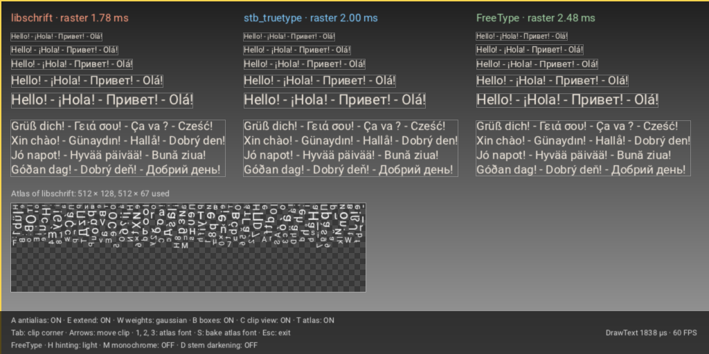
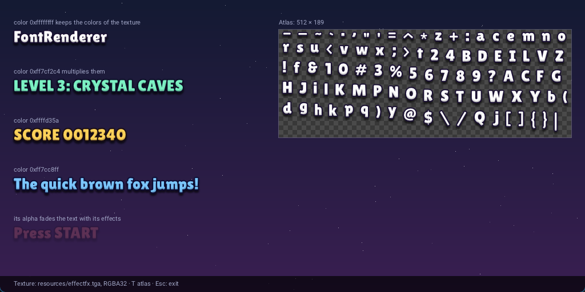
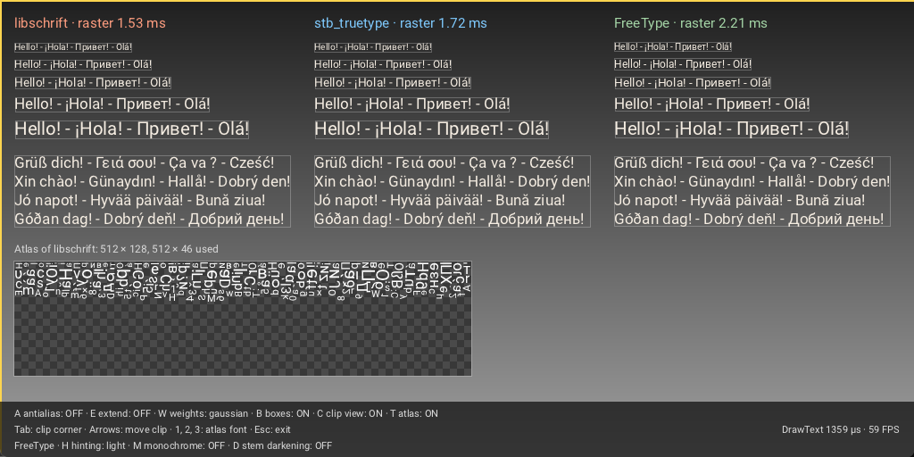
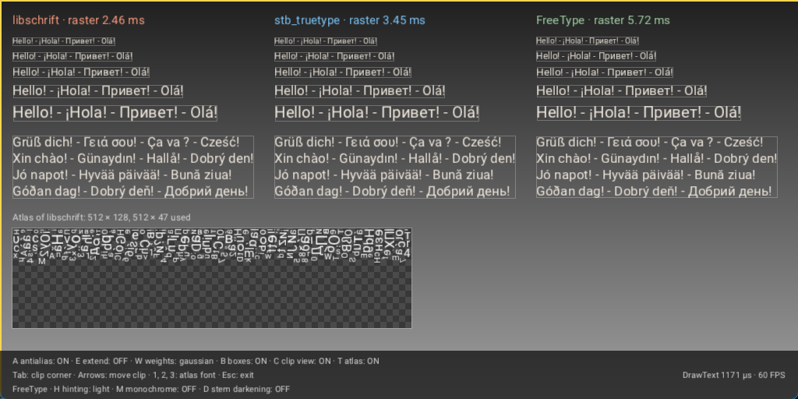
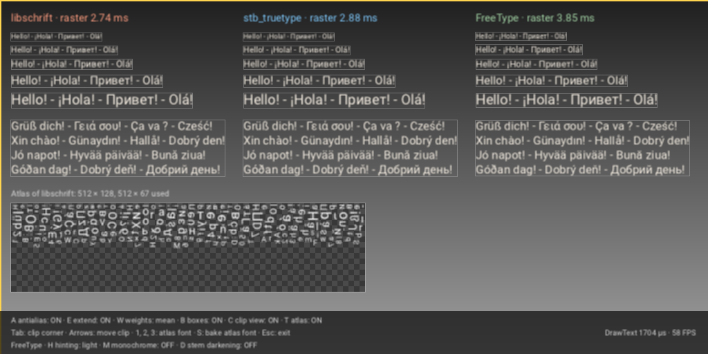
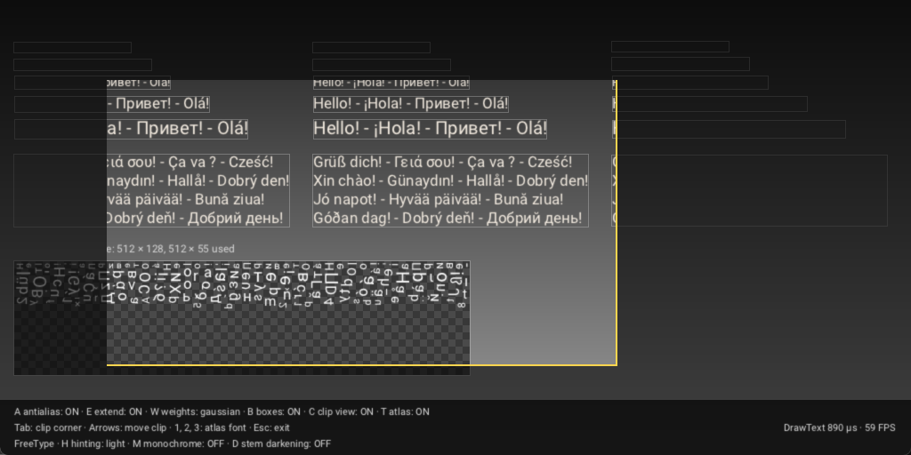
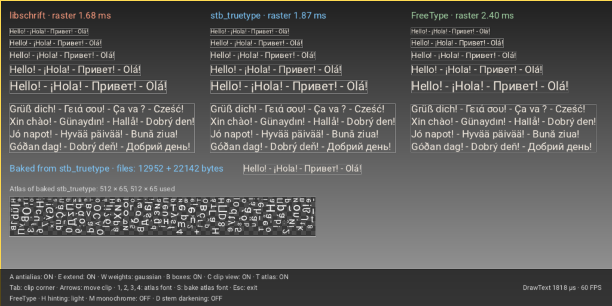

# FontRenderer

FontRenderer draws text from a TrueType or OpenType font into a 32-bit pixel buffer, with clipping. It can also give where each glyph goes, to draw the text with the GPU.



- Three backends render the glyphs from a font file: stb_truetype, libschrift and FreeType. A fourth one, `FontBaked`, draws with glyphs saved before, without the font file and without a rasterizer. See [Baked fonts](#baked-fonts).
- Baked fonts can have effects, like a shadow, an outline or a gradient, added to their texture with an image program. See [Adding effects to the texture](#adding-effects-to-the-texture).
- Kerning from the `GPOS` table of OpenType, or from the `kern` table. See [Kerning](#kerning).
- An optional 3 × 3 antialias filter, with weights you choose.
- The position of each glyph and its area in the texture, to draw the text with the GPU. See [Drawing with the GPU](#drawing-with-the-gpu).
- The text is drawn with SSE2, x86-64-v2, x86-64-v3 (AVX2), NEON or WebAssembly SIMD, with exactly the same pixels as the scalar code. See [Benchmarks](#benchmarks).
- A C++ API and a C API.
- Windows, Linux, macOS, Android, the web and DOS. See [Platforms](#platforms).

## How to use it

FontRenderer needs a C++14 compiler and a C11 compiler, and CMake 3.16 or newer if you build it with CMake.

To build the examples and the unit tests and run them:

```text
cmake -S . -B build -DCMAKE_BUILD_TYPE=Release
cmake --build build --config Release
```

The programs are saved in `bin`, like `exampleRender` and the unit tests, `unitTests`. The examples read their fonts from `bin/resources`, so run them from `bin`.

You have two options to add FontRenderer to your project:

- Use CMake. Add FontRenderer with `add_subdirectory()` or `FetchContent`, and link against the `FontRenderer::FontRenderer` target.
  These options choose what is built:

  |Option|Default|What it builds|
  |---|---|---|
  |`FONTRENDERER_USE_STB`|`ON`|The stb_truetype backend, `FontSTB`|
  |`FONTRENDERER_USE_LIBSCHRIFT`|`ON`|The libschrift backend, `FontSFT`|
  |`FONTRENDERER_USE_FREETYPE`|`OFF`|The FreeType backend, `FontFT`. CMake uses the FreeType installed in the system, and downloads it if there is none|
  |`FONTRENDERER_USE_BAKED`|`ON`|The backend that reads baked fonts, `FontBaked`|
  |`FONTRENDERER_DISABLE_SIMD`|`OFF`|Only the scalar drawing code. By default the text is drawn with SSE2 where the compiler may use it, always on x86 of 64 bits, with NEON on ARM64, and with WebAssembly SIMD on the web|
  |`FONTRENDERER_USE_X86_64_V2`|`ON`|Only for x86 of 64 bits. The whole library is built for x86-64-v2 (SSE3, SSSE3, SSE4.1, SSE4.2 and POPCNT), and it stops the program at start, with a message, on a processor without that level. `OFF` builds the library for the default x86-64 level, which includes SSE and SSE2, and draws the text with a copy for x86-64-v2 only when the processor has it. The gain is small: the glyphs draw about 6 % faster. The comment of the option in `CMakeLists.txt` has the details|
  |`FONTRENDERER_USE_X86_64_V3`|`OFF`|Only for x86 of 64 bits. The library has a copy of the drawing for x86-64-v3 (AVX2). At 14 pixels it draws as fast as x86-64-v2, and the bigger the glyphs, the faster it is: see [Benchmarks](#benchmarks). `OFF` uses that copy only when the processor has the level. `ON` builds the whole library for x86-64-v3, whatever `FONTRENDERER_USE_X86_64_V2` says, and stops the program at start, with a message, on a processor without that level. The comment of the option in `CMakeLists.txt` has the details|
  |`FONTRENDERER_USE_WASM_SIMD`|`ON`|Only for Emscripten. It adds `-msimd128` to the library and to the programs that link it, so that the text is drawn with WebAssembly SIMD. A browser without WebAssembly SIMD cannot load the program. See [Platforms](#platforms)|
  |`FONTRENDERER_BUILD_EXAMPLES`|`ON` only when FontRenderer is the main project|The examples, which show every backend that is on. The [effects example](#the-effects-example) also needs `FONTRENDERER_USE_BAKED`. They download MiniFB, unless the project that adds FontRenderer already has a `minifb` target|
  |`FONTRENDERER_BUILD_TESTS`|`ON` only when FontRenderer is the main project|The unit tests|
  |`FONTRENDERER_BUILD_BENCHMARKS`|`OFF`|The benchmarks of the drawing code, `benchmarkDraw`, of the layout, `benchmarkLayout`, and of the rasterizers, `benchmarkRaster`. See [benchmarks/README.md](benchmarks/README.md)|

  At least one backend must be on. The library defines `FONTRENDERER_USE_STB`, `FONTRENDERER_USE_LIBSCHRIFT`, `FONTRENDERER_USE_FREETYPE` and `FONTRENDERER_USE_BAKED` for each backend that is on, also for the code that uses the library. The header of each backend, like `FontSTB.h`, stops the build if its macro is not defined.

  If `FONTRENDERER_USE_BAKED` is the only backend that is on, the library can draw baked fonts, but it cannot render glyphs from a font file, so it does not build `Font`. In that case CMake does not build the examples either, because they render glyphs from a font file, and the unit tests skip the tests that need one.

- Add the files to your project. Build every `.cpp` file of `src`, and also `src/external/libschrift/schrift.c` if you use libschrift: it is a modified copy, see [Dependencies](#dependencies). Add `src` and `src/external` to the include paths. With FreeType, also build and link FreeType on your own.
  Define the macro of each backend you want, `FONTRENDERER_USE_STB`, `FONTRENDERER_USE_LIBSCHRIFT`, `FONTRENDERER_USE_FREETYPE` or `FONTRENDERER_USE_BAKED`, for every file you compile. The file of a backend whose macro is not defined builds nothing. Without the macro of a backend that renders glyphs, `Font.cpp`, `GposKerning.cpp` and `SkylineBinPack.cpp` build nothing either.
  Some files of the SIMD code also build nothing unless you ask for them:

  - `GlyphDrawWasm.cpp` builds nothing without `-msimd128`.
  - `GlyphDrawX64v2.cpp` builds nothing unless you define `FONTRENDERER_USE_X86_64_V2` or `FONTRENDERER_USE_X86_64_V2_AT_RUNTIME`.
  - `GlyphDrawX64v3.cpp` builds nothing unless you define `FONTRENDERER_USE_X86_64_V3` or `FONTRENDERER_USE_X86_64_V3_AT_RUNTIME`.

  With a macro that ends in `_AT_RUNTIME`, build only its file for that level: `-march=x86-64-v2` or `/arch:SSE4.2`, and `-march=x86-64-v3` or `/arch:AVX2`. `Platform.h` explains these macros.

## API

The API is simple:

```cpp
const char *text = "Hello World!";
uint32_t   fontSize = 32;
uint32_t   color32 = 0xffff0000;   // ARGB. With alpha 0 the text is invisible

// Load a font
MindShake::FontSTB font("resources/Roboto-Regular.ttf");
if (font.GetStatus() != MindShake::FontBase::EStatus::Ok) {
    // The file is missing or it is not a valid font
}

// Set the clipping (optional, but without it the text must fit inside the buffer)
font.SetClipping(left, top, right, bottom);

// Enable antialias
font.SetAntialias(true);
font.SetAntialiasWeights(20, 4, 1); // Gaussian
//font.SetAntialiasWeights(1, 1, 1);  // Mean, instead of Gaussian

// Allow antialias to extend one border pixel per glyph
font.SetAntialiasAllowEx(true);

// Empty pixels between the glyphs in the texture, so that bilinear filtering does not mix neighbouring glyphs (1 by default)
font.SetGlyphSpacing(1);

// In case you need the dimensions of the future rendered text. For instance to horizontal align text...
MindShake::FontBase::Rect rect;
font.GetTextBox(text, fontSize, &rect);

// Draw a colored text of height fontSize in your buffer at pos (posX, posY)
font.DrawText(text, fontSize, color32, bufferDest, bufferDestStride, posX, posY);
```

`bufferDest` is an array of `uint32_t` pixels, one row after another, and `bufferDestStride` is the distance between two rows, in pixels, not in bytes. Each pixel is `0xAARRGGBB`, like `color32`, so in memory, on a little-endian processor, its bytes are blue, green, red and alpha. This is the order of the 32-bit window buffers of Windows, macOS and Linux. `posX` and `posY` are the top-left corner of the text.

`GetStatus` says whether the font loaded: `EStatus::Ok`, or the reason it failed, like `CannotOpenFile` or `InvalidFont`.

**Note**: Each glyph is rendered only once per fontSize, so changing any antialias setting, the glyph spacing or the [glyph padding](#adding-effects-to-the-texture) discards the glyphs already rendered.

**Note**: By default the packer can rotate a glyph to fit more glyphs in the texture. With SIMD, a rotated glyph usually draws between 6 and 30 % more slowly (see [Benchmarks](#benchmarks)). If drawing speed matters more than texture space, call `SetAllowRotation(false)` before rendering the glyphs.

**Note**: `DrawText` also blends the alpha of the buffer, as the *over* operator of Porter and Duff does. An opaque buffer stays opaque. On a transparent buffer, the result has premultiplied alpha: blue, green and red are multiplied by the alpha. A buffer that already has translucent pixels must have premultiplied alpha too. The color of the text is not premultiplied. See [How a pixel is blended](#how-a-pixel-is-blended).

**Note**: Some limits:

- `fontSize` is a `uint8_t`, so the text is at most 255 pixels high.
- A `'\n'` in the text starts a new line.
- FontRenderer has no text shaper: it draws each character with its own glyph, from left to right. Scripts that need shaping, like Arabic or Devanagari, do not look right, and right-to-left text is not reordered.
- A font is not thread safe: use each one from a single thread at a time.

### Classes

- `FontBase` lays out and draws text with the glyphs a font already has. `DrawText`, `GetTextBox` and `GetGlyphQuads` are here.
- `Font` renders its glyphs from a font file the first time they are drawn. `FontSTB`, `FontSFT` and `FontFT` are its backends.
- `FontBaked` only reads the glyphs that a `Font` saved before. See [Baked fonts](#baked-fonts).

### Other settings of Font

- `SetSizeMode` chooses what `fontSize` measures. With `ESizeMode::LineHeight`, the default, it is the height from the highest ascender to the lowest descender. With `ESizeMode::EmSize` it is the typographic size, as `font-size` in CSS, so the height of a line depends on the font. Changing it discards the glyphs already rendered.
- `SetTextureGrowth` chooses which sides of the texture double when a glyph does not fit: `ETextureGrowth::Height` (the default), `Width` or `Both`. Growing the width copies the whole texture, because the rows change length. The texture does not grow past `kMaxTextureSize` (16384) texels on a side, and a glyph that does not fit then stays empty until `Reset`.
- `SetPackingHeuristic` chooses how the packer, a skyline packer by Jukka Jylänki, places the glyphs: `LevelBottomLeft` (the default) or `LevelMinWasteFit`. It only changes the glyphs packed afterwards.

### C API

`FontC.h` has the same functions for C, with names like `fr_font_draw_text`. Each function that can fail returns an `fr_status`. [exampleRenderC.c](examples/exampleRenderC.c) uses it.

```c
fr_font *font = NULL;
if (fr_font_create("resources/Roboto-Regular.ttf", FR_FONT_BACKEND_STB, &font) != FR_STATUS_OK) {
    // The file is missing, it is not a valid font, or the library was built without that backend
}

fr_font_set_clipping(font, left, top, right, bottom);
fr_font_set_antialias(font, true);
fr_font_draw_text(font, "Hello World!", 32, 0xffff0000, buffer_dest, buffer_dest_stride, pos_x, pos_y);

fr_font_destroy(font);
```

`fr_font_create_baked` creates a [baked font](#baked-fonts).

## Baked fonts

A `Font` can save the glyphs it has rendered, and `FontBaked` can draw text with them later, without the font file and without a rasterizer. This is useful on computers that are too slow to rasterize glyphs, like DOS computers, or to ship a program without the font and its rasterizer.

`FontBaked` cannot render new glyphs. It does not draw a code point or a height that was not saved.

```cpp
MindShake::FontSTB font("resources/Roboto-Regular.ttf");
font.SetAntialias(true);

// Render every glyph the program will draw, at every height it will use.
font.Preload(u8"ABCDEFGHIJKLMNOPQRSTUVWXYZabcdefghijklmnopqrstuvwxyz0123456789 .,:;!?¿¡áéíóúñÑ", 16);
font.Preload(u8"0123456789", 32);

// Look up the kerning of every pair of rendered glyphs. It can be very slow with many glyphs.
font.LoadAllKerningPairs();

font.SaveBaked("roboto.frb", "roboto.tga");
```

And later, maybe in another program:

```cpp
MindShake::FontBaked font("roboto.frb", "roboto.tga");
font.DrawText("Hello", 16, color32, bufferDest, bufferDestStride, posX, posY);
```

`Preload` packs all the glyphs of the text together, which fills the texture better than drawing them one by one. `SaveBaked` saves every glyph rendered so far, also the ones rendered by `DrawText` or `GetTextBox`. It only saves the kerning pairs already looked up, so call `LoadAllKerningPairs` first.

`SaveBaked` writes two files:

- The metrics file has the metrics of each height, the position of each glyph in the texture, and the kerning. It is a little-endian binary file, so it works the same on every platform.
- The texture is an 8-bit grayscale TGA compressed with RLE, which most image programs read. It only has the used area of the texture. `FontBaked` reads it compressed or not, with its rows from the top down or from the bottom up. It also reads a TGA with alpha, see [Adding effects to the texture](#adding-effects-to-the-texture).

You can convert the texture to another format, like PNG, and decode it yourself. Then pass the pixels to `FontBaked(metricsFile, texture, width, height, format)`, with `ETextureFormat::Alpha8` for one byte per texel, or `ETextureFormat::BGRA32` for four: blue, green, red and alpha. Use `ETextureFormat::BGRA32Premultiplied` instead if blue, green and red are already multiplied by the alpha. The size must be the same. If the texture is only in the GPU, pass `nullptr`: `DrawText` then draws nothing, but `GetGlyphQuads` still works.

### Adding effects to the texture

You can add effects to the saved texture with an image program, like a shadow, an outline or a gradient, and `FontBaked` draws them:

1. Before rendering the glyphs, leave room for the effects with `SetGlyphPadding(left, top, right, bottom)`. These empty pixels are part of each glyph, so `DrawText`, `GetTextBox` and `GetGlyphQuads` include them. For example, a shadow 3 pixels to the right and 3 pixels down needs `SetGlyphPadding(0, 0, 3, 3)`.
2. If an effect is not symmetric about the diagonal, like a vertical gradient or a shadow that goes further right than down, call `SetAllowRotation(false)` too. The packer can rotate a glyph to fit it better, and it stores a rotated glyph transposed, so such an effect would look wrong on it.
3. Save the font with `SaveBaked`, add the effects to the texture, with an image program or with a script like the one in [the effects example](#the-effects-example), and save it as a 32-bit TGA with alpha, compressed or not. The alpha must cover the text and its effects. Some programs save the alpha of a TGA from a separate alpha channel, not from the transparency of the layer, so check which one yours uses.

`FontBaked` reads the 32-bit TGA as a color texture. It also reads a 16-bit grayscale TGA with alpha, as a color texture with the gray in blue, green and red. It keeps a color texture with premultiplied alpha, so `GetTextureFormat` gives `BGRA32Premultiplied`: it multiplies blue, green and red by the alpha when it reads the texture. A TGA whose TGA 2.0 extension area says that the alpha is already premultiplied is kept as it is. `WriteTga` writes that extension area when you save a premultiplied texture with `ETgaAlpha::Premultiplied`.

A TGA can say that it has no alpha. Some programs write an alpha without saying it, so `FontBaked` still uses the alpha if it changes from pixel to pixel. If it is the same in every pixel, there is no text in it, and `FontBaked` gives `EStatus::InvalidTexture`. It gives the same status for a color TGA with 24 bits, and for a texture whose size is not the one in the metrics file.

`DrawText` multiplies the color of each texel by the color of the text, as a GPU does with the color of a vertex. So white text keeps the colors of the texture, and a white glyph with a black outline, drawn in red, is red with a black outline.

```cpp
MindShake::FontSTB font("resources/Roboto-Regular.ttf");
font.SetGlyphPadding(2, 2, 5, 5);
font.SetAllowRotation(false);
font.Preload(u8"ABCDEFGHIJKLMNOPQRSTUVWXYZabcdefghijklmnopqrstuvwxyz0123456789 .,:;!?", 32);
font.LoadAllKerningPairs();
font.SaveBaked("roboto.frb", "roboto.tga");

// Later, after adding the effects to roboto.tga and saving it with 32 bits:
MindShake::FontBaked baked("roboto.frb", "roboto.tga");
baked.DrawText("Hello", 32, 0xffffffff, bufferDest, bufferDestStride, posX, posY);
```

The glyph spacing, set with `SetGlyphSpacing`, is a different thing: the empty pixels between the glyphs in the texture, so that bilinear filtering does not mix neighbouring glyphs. It is not part of any glyph, so an effect must not use it.

### The effects example

Two programs and a script show the whole process, with the font [Lilita One](https://fonts.google.com/specimen/Lilita+One):

1. `exampleBakeEffects` bakes the printable ASCII characters at 32 pixels, with a glyph padding of (6, 4, 6, 10) and without rotation. It saves `resources/effects.frb` and `resources/effects.tga`, the texture in grayscale.
2. [tools/add_effects.py](tools/add_effects.py) adds a 2 pixel dark outline, a shadow 4 pixels down and a bevel lit from above, and saves `resources/effectfx.tga`. The glyphs stay white, so the color of the text tints them while the outline stays dark. It needs Python with numpy and Pillow, and its settings are at the top of the file. An image program can do the same.
3. `exampleEffects` draws with `FontBaked` and that texture: once in white, which keeps the colors of the texture, and then in other colors, one of them fading with its alpha.



The repository already has the files of the three steps, so `exampleEffects` works without running the others. If you bake the font again, run the script again too: the texture with the effects must come from the same bake as the metrics file.

## Drawing with the GPU

`GetGlyphQuads` gives the glyphs that `DrawText` would draw: where each one goes, relative to the position of the text, and the area of the texture it uses. Draw a textured quad for each one. The clipping does not apply to the quads.

The packer can rotate a glyph to fit it better, unless you call `SetAllowRotation(false)`. A rotated glyph is stored transposed: the pixel (x, y) of the quad is the texel (textureRect.x + y, textureRect.y + x).

`GetTextureFormat` says how to upload the texture. A `Font` always has an `Alpha8` texture, with one byte of coverage per texel. A `FontBaked` with a color texture has a `BGRA32Premultiplied` texture: the bytes blue, green, red and alpha, with blue, green and red multiplied by the alpha. Draw it with the blend of premultiplied alpha, `glBlendFunc(GL_ONE, GL_ONE_MINUS_SRC_ALPHA)` in OpenGL or `D3D11_BLEND_ONE` and `D3D11_BLEND_INV_SRC_ALPHA` in Direct3D, and premultiply the color of the vertices too. Premultiplied alpha also filters correctly: bilinear filtering and mipmaps do not darken the edges of the effects. The byte order is the order of the TGA file and of the 32-bit window buffers of Windows, macOS and Linux, so `DrawText` does not reorder the channels. Upload it with `GL_BGRA` and `GL_UNSIGNED_BYTE` in OpenGL, or as `DXGI_FORMAT_B8G8R8A8_UNORM` in Direct3D. OpenGL ES and WebGL only accept `GL_BGRA` with an extension: upload the bytes as `GL_RGBA`, and swap red and blue in the shader with `.bgra`, which costs nothing.

With `Font`, drawing or measuring text can render new glyphs and change the texture. `GetTextureVersion` changes every time the texels change, so compare it with the version you uploaded to know when to upload the texture again.

## How a pixel is blended

The scalar, SSE2, x86-64-v2, x86-64-v3, NEON and WebAssembly SIMD code leave exactly the same pixels.
Each channel is a value from 0 to 255, and each operation below works on every channel.

- `tintColor` is the color of the text, not premultiplied.
- `fontTexture` is the font texel, premultiplied.
  - A texel of an `Alpha8` texture is a coverage: `(coverage, coverage, coverage, coverage)`.
  - A texel of a `BGRA32Premultiplied` texture is: `(round(r * coverage / 255), round(g * coverage / 255), round(b * coverage / 255), coverage)`.
- `dest` is the pixel of the buffer. In an opaque buffer, as a screen buffer usually is, premultiplied alpha changes nothing. A buffer with translucent pixels must have premultiplied alpha, and it keeps it.

```text
premultipliedTint.rgb = round(tintColor.rgb * tintColor.a / 255)
premultipliedTint.a   = tintColor.a

source      = fontTexture * premultipliedTint
sourceAlpha = round(source.a / 255)

dest = round((source + dest * (255 - sourceAlpha)) / 255)
```

This is the *over* operator with premultiplied alpha.
`source` is not divided by 255 before it is added to `dest`, so each channel is rounded only once. The division rounds exactly to the nearest integer for every value the blend can produce: `round(sum / 255) = (sum + 128 + ((sum + 128) >> 8)) >> 8`.

## Platforms

Tested on Windows, Linux, macOS (Intel and Apple M1), Android (arm64 phones and the x86_64 emulator), the web (Emscripten) and DOS (DJGPP, in DOSBox-X). iOS uses the same POSIX code as macOS, but it is not tested.

On the web, the text is drawn with WebAssembly SIMD. The option `FONTRENDERER_USE_WASM_SIMD`, on by default, adds `-msimd128` to the library and to the programs that link it, because a browser without WebAssembly SIMD cannot load a module that has any SIMD instruction. Browsers have it since Chrome 91, Firefox 89 and Safari 16.4. To support older ones, build the program twice, with the option on and off, and pick one in JavaScript with `WebAssembly.validate` on a small module that has a SIMD instruction, as the `wasm-feature-detect` library does. How much faster it draws than the scalar code is in [Benchmarks](#benchmarks). With `-msse2` or `-mfpu=neon`, the library still draws with its WebAssembly code, which was faster than the SSE2 and NEON code translated by Emscripten.

DOS support is minimal. DOS cannot map files, so the whole font is loaded into memory, and rasterizing TrueType glyphs is slow on computers of that time. On DOS, a [baked font](#baked-fonts) is a better choice: build only `FONTRENDERER_USE_BAKED`, and save the font on another computer. The example also needs long file names (`lfn = true` in DOSBox-X) to find its font file.

## Dependencies

For getting the font glyphs the following libraries are used:

- [stb_truetype](https://github.com/nothings/stb/blob/master/stb_truetype.h) (.ttf, .otf) :ok:
- [libschrift](https://github.com/tomolt/libschrift) (.ttf, and .otf with TrueType outlines: it cannot read CFF outlines) :ok:
- [FreeType](https://freetype.org/) (.ttf, .otf, and the other scalable formats it reads) :ok: (optional). `FontFT` also has hinting, a monochrome mode and stem darkening, which make small text sharper. See `FontFT.h`.

`FontBaked` does not need any of them: it only reads the files that a `Font` saved.

**Note**: The copy of libschrift in `src/external/libschrift` is version 0.10.2 with some changes. FontSFT needs them, so use this copy and not the upstream one:

- `sft_unitsPerEm()` returns the units per em of the font.
- `SFT_GMetrics::xOffset` gives the horizontal position of the image that `sft_render` produces. It can differ from the left side bearing.
- Extra bounds checks for the pairs of the `kern` table and for the groups of the format 12 and 13 `cmap` subtables.
- The rasterizer keeps its cells on the heap. Upstream reserves 256 KB of stack for them on every glyph, which overflows the default 64 KB stack of Emscripten.
- It builds with DJGPP (DOS). `getu32` has the same return type in its declaration and in its definition, and `sft_loadfile` always fails because DOS cannot map files. FontSFT uses `sft_loadmem`, so this does not affect it.

## Kerning

Every backend reads the kerning of pairs of glyphs from the `kern` feature of the OpenType `GPOS` table with `GposKerning`. stb_truetype only reads part of `GPOS`, and libschrift does not read it. `GposKerning` reads pair adjustments in both formats and with any value format, also inside extension lookups, in `GPOS` 1.0 and 1.1. As in HarfBuzz, a font without that kerning uses its `kern` table instead.

FontRenderer does not know the script of the text, and a font can kern the same pair differently in each script. `GposKerning` uses the first script whose kerning has the pair: Latin, then the default script, then the rest in the order of the font.

Kerning that depends on more than two glyphs needs a text shaper like HarfBuzz, so FontRenderer does not apply it.

## Benchmarks

The drawing code picks the fastest level that the processor has. The table shows how many times faster than the scalar code it drew the glyphs, both measured in the same executable. Each number is the median of all the scenarios of that size, the processors, the compilers and the runs:

- x86: six Intel processors, from a Westmere of 2010 to an Alder Lake of 2022, with MSVC, clang and GCC. The Westmere ran a 32-bit Windows, so it only counts for SSE2.
- NEON: an Apple M1 Pro with Apple clang 16, and two phones with a Cortex-A78 (OnePlus 9 and Xiaomi 24094RAD4G) with the clang 18 of the NDK.
- WebAssembly SIMD: an i7-10850H in Node, Chrome, Edge and Firefox, and two phones in Chrome, the OnePlus 9 and a Huawei P20 Pro (Cortex-A73). Here the scalar code is also WebAssembly.

|Code|14 px|24 px|40 px|96 px|BGRA32 texture|
|---|---|---|---|---|---|
|SSE2|2.5|2.8|3.4|3.9|4.1|
|x86-64-v2|2.6|2.9|3.7|4.0|4.3|
|x86-64-v3|2.6|3.3|4.5|5.5|5.7|
|NEON, Apple M1 Pro|3.3|3.1|3.4|5.1|5.9|
|NEON, Cortex-A78|1.5|1.4|1.6|2.0|2.2|
|WebAssembly SIMD, x86-64|2.1|2.3|2.8|3.0|3.6|
|WebAssembly SIMD, phones|1.6|1.7|2.0|2.3|2.4|

The larger the glyphs, the more the wider registers help. At 14 pixels each row of a glyph is short, so the three x86 levels draw at about the same speed. NEON gains much less on the Cortex-A78 than on the M1, which decodes twice as many instructions per cycle and has twice as many NEON units. Safari has not been measured.

With the SSE2 and NEON code, a rotated glyph usually draws between 6 and 30 % more slowly than an upright one, on x86 with GCC and MSVC, an Apple M1, a Cortex-A78 and a Cortex-A55. There are exceptions: on x86, glyphs of 96 pixels drew faster rotated, and so did glyphs of 24 and 40 pixels on the Cortex-A55. The scalar code draws both at the same speed. With the x86-64-v3 code, rotated and upright glyphs have not been compared.

How to build and run the benchmarks is in [benchmarks/README.md](benchmarks/README.md).

## Captures

The examples use the Mini Frame Buffer (MiniFB) library to create a window and draw the text in it. `exampleRender`, and its C version `exampleRenderC`, show every backend that is on side by side, the atlas of one of them, and the keys in the status bar. S bakes the font of the shown atlas: it saves `baked.frb` and `baked.tga` next to the example, reads them back with `FontBaked`, and draws a row with it. The baked row keeps the settings it was saved with, so the antialias keys do not change it.

|Capture|Settings|
|---|---|
||No antialias|
||Antialias with Gaussian weights|
||Antialias with Gaussian weights, glyphs extended one pixel|
||Antialias with mean weights, glyphs extended one pixel|
||Clipping (the darkened area) and the atlas of stb_truetype|
||The font of stb_truetype baked with S: its row, drawn with `FontBaked`, and its atlas|

## Licenses

FontRenderer is distributed under the Boost Software License 1.0, see [LICENSE](LICENSE).

The licenses of the third party code and fonts in this repository are in [LICENSES](LICENSES): stb_truetype, libschrift, pixman, doctest, and the Roboto, DejaVu and Lilita One fonts used by the examples and the tests. The textures in `bin/resources` are baked from Lilita One.

CMake downloads MiniFB for the examples, and FreeType when `FONTRENDERER_USE_FREETYPE` is on and the system has none. They are not part of this repository and have their own licenses. If your program uses the FreeType backend, it includes FreeType, whose license (the FreeType License or the GPLv2, as you choose) asks you to credit FreeType in your documentation.

## Use of AI

I used Claude, from Anthropic, as a helper during the development. I chose what to try, and every change that went into the library was my decision.

Claude did most of the work in three areas:

- **Tests.** The unit tests check, among other things, that the scalar, SSE2, x86-64-v2, x86-64-v3, NEON and WebAssembly SIMD code leave exactly the same pixels, that drawing a glyph reads and writes only its own texels and pixels.
- **Benchmarks.** The three benchmark programs, the variants that try one idea each against the code of the library, the scripts that run them on Windows, Linux, macOS, Android and in the browser, and the HTML pages with charts.
- **Analysis of the results.** The benchmarks ran on six x86 processors, an Apple M1, several Android phones and four web runtimes, with several compilers, two runs each. Claude compared those results and separated real gains from noise. For example, the same code can run up to 10 % faster or slower when it moves to another address in the program, so a gain smaller than that had to repeat to count. With that data I decided which ideas went into the library and which were dropped.
